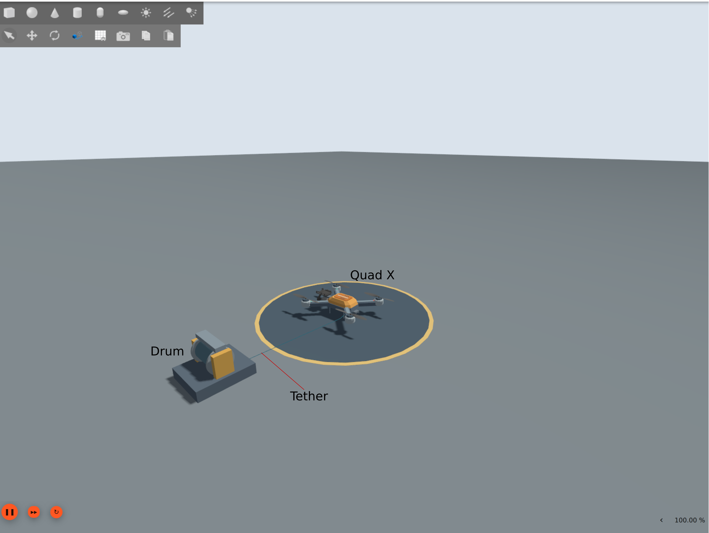
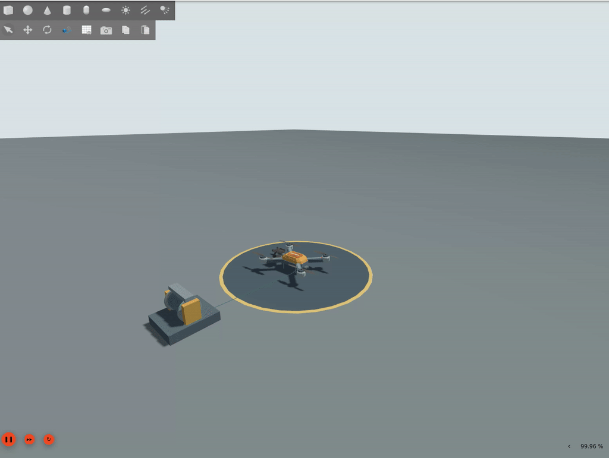
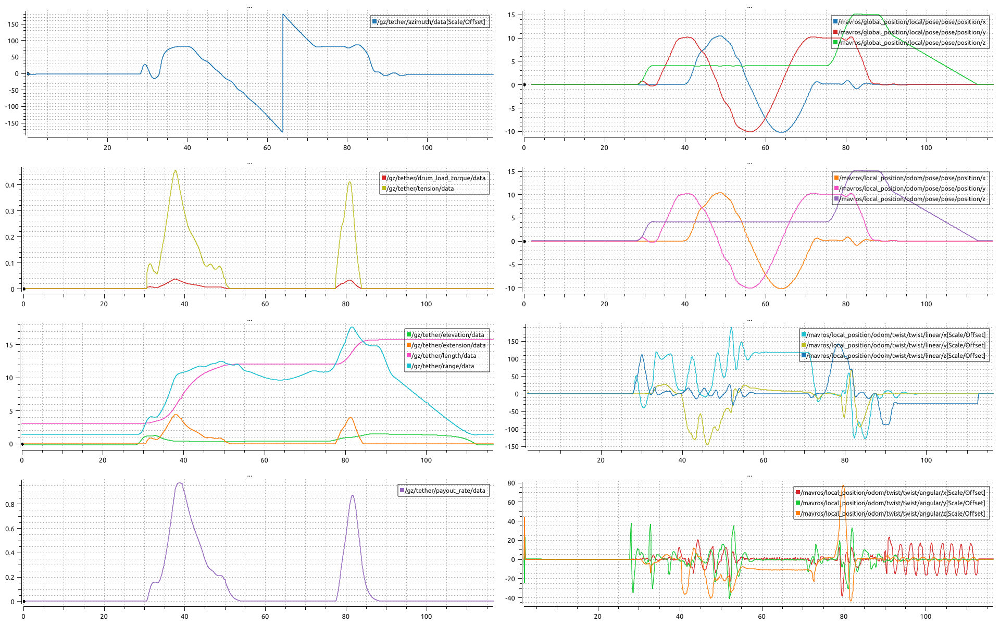

# ArduPilot ROS 2 development workspace

Develop and test ArduCopter with SITL, Gazebo Harmonic, ROS 2 Humble, and MAVROS. Choose the Iris runway, the free-flight Quad X test field, or the tethered Quad X test field. MAVROS connects to SITL over MAVLink and also supports a standalone connection to a physical flight controller. Gazebo sensor and simulation topics reach ROS 2 through `ros_gz_bridge`.

## Quick start

Clone the repository with its submodules.

```bash
git clone --recurse-submodules https://github.com/seifEddy/ardupilot-ros2-dev.git
cd ardupilot-ros2-dev
```

Follow the [ROS 2 workspace setup](ros2_ws/README.md#build) to build and source the workspace. Then run one of the following commands.

- **Iris runway** launches the original Iris model for free flight.

  ```bash
  ros2 launch robot_description copter_sim.launch.py world:=iris mode:=gui
  ```

- **Tethered Quad X** launches the Quad X and its ground station.

  ```bash
  ros2 launch robot_description copter_sim.launch.py world:=quad_x_tether mode:=gui
  ```

- **Free-flight Quad X** launches the same aircraft in the test field without the tether. This is the default world if you omit `world`.

  ```bash
  ros2 launch robot_description copter_sim.launch.py world:=quad_x mode:=gui
  ```

Omit `mode:=gui` for headless rendering. See the [ArduPilot workspace guide](ardupilot_ws/README.md) for standalone Gazebo and SITL commands, MAVProxy setup, and the optional circle-flight demo.

## Tethered Quad X

The tethered world adds an anchored ground station with a rotating winch drum. The cable goes slack when the aircraft is within the paid-out length and pulls toward the fairlead when stretched. Automatic take-up winds excess cable back in above the initial 3.0 m, using a configurable winding force and retraction speed limit. When tension overcomes the take-up torque and brake resistance, the aircraft can pull cable off the drum. The winch limits payout speed and travel, and accepts manual length commands on `/gz/tether/cmd_length`.

The ROS 2 bridge publishes paid-out length, endpoint range, extension, payout rate, tension, fairlead force, azimuth, elevation, and drum load torque under `/gz/tether/`. Use `ros2 topic list` to discover the topics, or plot them in PlotJuggler. See the [tether model guide](ardupilot_ws/gz_ws/src/ardupilot_gazebo/docs/quad_x_tether.md) for current take-up settings and measurements. The [tether implementation and theory (PDF)](docs/quad-x-tether-implementation.pdf) describes the original braked-winch model, station joints, equations, and references.

The [ROS 2 tether supervisor](ros2_ws/README.md#run-the-tether-supervisor) reconstructs relative XYZ position from endpoint range, azimuth, and elevation, then commands proportional XYZ velocity in GUIDED mode. X and Y targets are zero. The `target_altitude_z` ROS parameter sets the desired relative altitude and can be updated while the node runs. The demo requests arming and takeoff when started, and publishes relative and translated position diagnostics for comparison with MAVROS telemetry.

### Gazebo views and flight telemetry

Quad X and its fairlead immediately after spawning.



The optional circle-flight demo shows the tethered Quad X taking off and flying a circle.



The plots below show aircraft and tether telemetry from a separate rosbag replay. The recording is available upon request.


